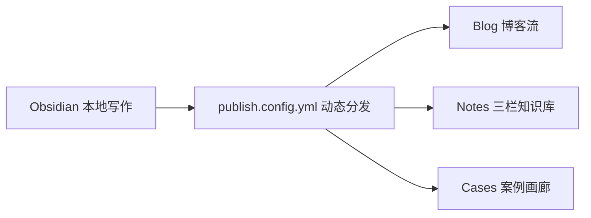

这个站点直接由我的 **Obsidian** 知识库自动构建生成。

在日常记录时，我依然保持在 Obsidian 中的纯粹写作体验，通过根目录的 `publish.config.yml` 即可灵活控制每个文件夹的展示形态：

1. **博客（Blog）**：放日常随笔、月度总结与独立技术分享，按时间流呈现。
2. **知识归纳（Notes）**：对应 `ai/` 与 `od/` 等体系化学习目录，进入阅读页后会自动开启 ==三栏电子书阅读模式==（左侧章节树、中间正文、右侧滚动跟随大纲）。
3. **实战案例（Cases）**：以画廊卡片的形式呈现智能体工作流与项目案例。

### 支持的 Obsidian 进阶特性展示

- **全站快捷键搜索**：随时按下 `Ctrl + K`（或点击顶部导航栏搜索按钮）即可检索全站笔记。
- **双向链接与反向链接**：比如这里引用了算法笔记 [[01 字符串]] 与 AI 笔记 [[1-基础知识]]，点进对应笔记底部会自动显示「提及本文的笔记（Backlinks）」。
- **Mermaid 流程图自动渲染**：



- **代码块语法高亮与一键复制**：

```go
package main

import "fmt"

func main() {
    // 点击右上角按钮即可一键复制代码
    fmt.Println("Hello, Digital Garden!")
}
```
